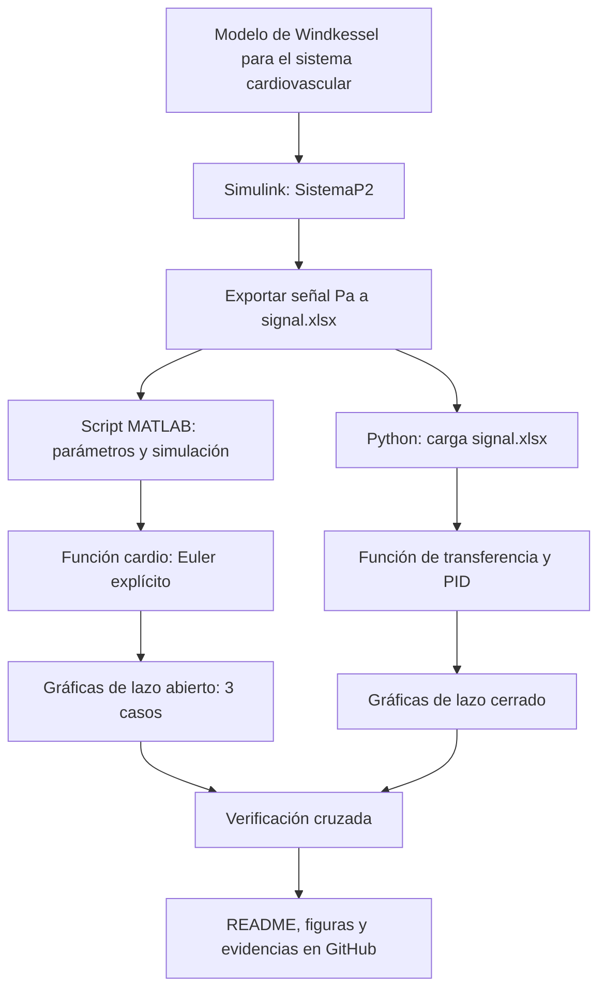

[](https://matlab.mathworks.com/open/github/v1?repo=DrPaulValle/MSFBP0)

# Práctica 0 — Modelo de mecánica pulmonar de segundo orden

Repositorio académico de la asignatura **Modelado de Sistemas Fisiológicos**, correspondiente al programa de **Ingeniería Biomédica** del Tecnológico Nacional de México / Instituto Tecnológico de Tijuana. Esta práctica introductoria integra modelado matemático, analogías eléctricas de sistemas fisiológicos, análisis temporal y de estabilidad, diseño de controladores PID, simulación computacional y comprobación experimental.

El caso de estudio representa la **dinámica cardiovascular** mediante el modelo de Windkessel con un circuito **RLC de segundo orden**. Se busca reproducir y comparar la respuesta de la presión de salida $P_p(t)$ ante diferentes condiciones clínicas (hipotensión, normotensión e hipertensión) y evaluar el efecto de un controlador PID en lazo cerrado.

**Docente:** Dr. Paul Antonio Valle Trujillo  
**Correo:** paul.valle@tectijuana.edu.mx  
**Departamento:** Ingeniería Eléctrica y Electrónica  
**Institución:** Tecnológico Nacional de México / Instituto Tecnológico de Tijuana  
**Asignatura:** Modelado de Sistemas Fisiológicos  
**Programa:** Ingeniería Biomédica  
**Estudiante:** Nombre completo · Número de control · correo@tijuana.tecnm.mx

**Repositorio de la asignatura:** https://github.com/DrPaulValle/MSF-IBF1020  
**Sede:** Blvd. Alberto Limón Padilla s/n, Tijuana, C. P. 22454, B. C., México.

---

<a id="contenido"></a>
## Contenido

1. [Resumen](#resumen)
2. [Competencia y objetivos](#objetivos)
3. [Relación con el temario](#temario)
4. [Modelo físico y analogía eléctrica](#analogia)
5. [Formulación matemática](#modelo)
6. [Análisis temporal y de estabilidad](#analisis)
7. [Señales de entrada y condiciones de simulación](#senales)
8. [Implementación en MATLAB, Simulink, Simscape y Python](#matlab)
9. [Control en lazo cerrado y sintonización PID](#pid)
10. [Resultados y verificación cruzada](#resultados)
11. [Flujo de trabajo](#flujo)
12. [Actividades del estudiante](#actividades)
13. [Estructura del repositorio](#estructura)
14. [Requisitos](#requisitos)
15. [Reproducibilidad y entregables](#reproducibilidad)
16. [Referencias](#referencias)

---

<a id="resumen"></a>
## Resumen

La práctica tiene como propósito **reproducir un procedimiento completo de modelado, análisis, simulación y control** del sistema cardiovascular utilizando el modelo de Windkessel. La dinámica del sistema arterial se aproxima mediante un circuito eléctrico equivalente compuesto por una impedancia característica  $Z$, una inertancia $L$, una compliancia $C$ y una resistencia periférica $R$. A partir de las leyes de Kirchhoff se obtiene un modelo integro-diferencial, su función de transferencia y una representación equivalente mediante ecuaciones diferenciales ordinarias de primer orden.

Se estudian la estabilidad del modelo a través de sus polos en tres escenarios clínicos: **Hipotenso**, **Normotenso** e **Hipertenso**. La simulación se realiza en **Simulink** (`SistemaP2`), de donde se extrae la señal de entrada \(P_a(t)\) y se exporta a un archivo de Excel (`signal.xlsx`). Posteriormente, mediante un script de MATLAB y una función de integración numérica (`cardio`), se resuelven las ecuaciones diferenciales ordinarias del sistema. Finalmente, se incorpora un **controlador PID** para evaluar la respuesta en lazo cerrado y se contrastan los resultados con una implementación en **Python**.

**Palabras clave:** Modelo de Windkessel; sistema cardiovascular; controlador PID; circuito RLC; modelado de sistemas fisiológicos; MATLAB; Simulink; Simscape Electrical; Python; simulación *in silico*.

[Volver al contenido](#contenido)

---

<a id="objetivos"></a>
## Competencia y objetivos

### Competencia a desarrollar

Comprender los conceptos básicos de Ingeniería de Control, la respuesta temporal y los criterios de estabilidad mediante la reproducción y verificación de un modelo matemático de segundo orden aplicado al sistema cardiovascular. La práctica permite familiarizarse con las herramientas computacionales, los instrumentos de laboratorio y los mecanismos de documentación empleados en actividades posteriores.

### Objetivo general

Reproducir y verificar el modelo de segundo orden del sistema cardiovascular (Windkessel) mediante su formulación matemática, implementación computacional en Simulink y MATLAB, y control con retroalimentación, comparando las respuestas obtenidas en tres condiciones clínicas.

### Objetivos específicos

- Identificar la entrada, la salida, el flujo sanguíneo y los parámetros del circuito equivalente.
- Obtener la función de transferencia del sistema a partir de las leyes de Kirchhoff y la transformada de Laplace.
- Formular las ecuaciones integro-diferenciales y su representación equivalente como sistema de ecuaciones diferenciales ordinarias lineales de primer orden.
- Determinar el error en estado estacionario para una entrada escalón y analizar la estabilidad mediante los polos de la planta en los tres casos clínicos.
- Simular el modelo con ecuaciones integro-diferenciales, función de transferencia y componentes de Simscape Electrical.
- Comparar las respuestas de los casos Normotenso, Hipotenso e Hipertenso.
- Implementar un controlador PID y sintonizar sus ganancias para cumplir los criterios de desempeño establecidos.
- Reproducir las respuestas de lazo abierto y lazo cerrado mediante MATLAB y Python.
- Documentar los resultados numéricos y computacionales en un repositorio de GitHub.

[Volver al contenido](#contenido)

---

<a id="temario"></a>
## Relación con el temario

La práctica integra contenidos correspondientes a tres unidades de la asignatura **Modelado de Sistemas Fisiológicos (IBF-1020)**:

| Unidad | Área | Contenidos aplicados |
|---|---|---|
| I | Sistemas de control retroalimentados | Elementos del sistema de control, diagramas de bloques, respuesta ante distintas entradas, análisis de error y criterios de estabilidad |
| II | Modelado matemático | Analogía circuito–sistema respiratorio, leyes de Kirchhoff, modelo de segundo orden y función de transferencia |
| III | Controladores | Tipos de controladores, diseño del PID y sintonización de ganancias |

El enfoque combina **Ingeniería de Control, Electrónica Analógica, Ciencias de la Computación y Fisiología**, de acuerdo con la competencia general de la asignatura.

[Volver al contenido](#contenido)

---

<a id="analogia"></a>
## Modelo físico y analogía eléctrica

El sistema cardiovascular se aproxima mediante un circuito RLC usando el modelo de Windkessel, donde los componentes eléctricos representan las propiedades físicas del sistema arterial.

| Símbolo | Equivalente eléctrico | Interpretación fisiológica |
|---|---|---|
| $(P_a(t)$) | Voltaje de entrada | Presión aórtica (presión de eyección del ventrículo izquierdo) |
| $(P_p(t)$) | Voltaje de salida | Presión periférica (presión en la red arterial) |
| $(F_a(t)$) | Corriente total | Flujo sanguíneo aórtico |
| $(Z$) | Impedancia característica | Resistencia característica de la aorta |
| $(L$) | Inductancia | Inertancia de la sangre en la aorta |
| $(C$) | Capacitancia | Compliancia (distensibilidad) de las arterias |
| $(R$) | Resistencia | Resistencia vascular periférica (RVP) |

### Parámetros para los tres casos clínicos

Los valores de los componentes varían según la condición fisiológica simulada:

| Caso | $(Z$) | $(L$) | $(R$) | $(C$) | Condición |
|---|---:|---:|---:|---:|---|
| Hipotenso | $(0.010$) | $(0.001$) | $(1.000$) | $(3.500$) | Alta compliancia (arterias muy elásticas) |
| Normotenso | $(0.010$) | $(0.001$) | $(1.000$) | $(1.500$) | Compliancia normal |
| Hipertenso | $(0.010$) | $(0.001$) | $(1.000$) | $(1.000$) | Baja compliancia (arterias rígidas) |

[Volver al contenido](#contenido)

---

<a id="modelo"></a>
## Formulación matemática

**Funcion de Transferencia**

$$
\begin{align*}
F_a(t) &= F_z(t) + F_L(t) = F_c(t) + F_R(t) \\
F_z(t) &= \frac{P_a(t) - P_p(t)}{2} \\
F_L(t) &= \frac{1}{L} \int [P_a(t) - P_p(t)] \, dt \\
F_c(t) &= C \frac{dP_p(t)}{dt} \\
F_R(t) &= \frac{P_p(t)}{R}
\end{align*}
$$

**Transformada de Laplace**

$$
\begin{align*}
F_a(s) &= F_z(s) + F_L(s) = F_c(s) + F_R(s) \\
F_z(s) &= \frac{P_a(s) - P_p(s)}{2} \\
F_L(s) &= \frac{P_a(s)}{F_p(s)} \\
F_c(s) &= \frac{CsP_p(s)}{L_s} \\
F_R(s) &= \frac{P_p(s)}{R} \\
\frac{P_a(s) - P_p(s)}{2} + \frac{P_a(s) \cdot P_p(s)}{L_s} &= CsP_p(s) + P_p(s)
\end{align*}
$$

**Modelo de ecuaciones integro-diferenciales**

$$
F_z(t) + F_L(t) = F_c(t) + F_R(t)
$$

$$
\frac{P_a(t) - P_p(t)}{z} + \frac{1}{L} \int [P_a(t) - P_p(t)] \, dt = C \frac{dP_p(t)}{dt} + \frac{P_p(t)}{R}
$$

**Nota:** la única variable desconocida es la salida del sistema \(P_p(t)\). NO se puede despejar de términos en los que se esté derivando o integrando.
[Volver al contenido](#contenido)

---

<a id="analisis"></a>
## Análisis temporal y de estabilidad

### Caso Hipotenso

$$
\begin{align*}
z &= 0.010 \quad \frac{P_p(s)}{P_a(s)} = \frac{0.001s + 0.010}{3.5 \times 10^{-5}s^2 + 0.00101s + 0.01} \\
R &= 1.000 \quad \lambda_1 = -14.429 + 8.805 \quad \text{li} \\
C &= 3.500 \quad \lambda_2 = -14.429 - 8.805 \quad \text{li}
\end{align*}
$$

Respuesta Subamortiguada.

### Caso Normotenso

$$
\begin{align*}
z &= 0.010 \quad \frac{P_p(s)}{P_a(s)} = \frac{0.001s + 0.01}{1.5 \times 10^{-5}s^2 + 0.00101s + 0.01} \\
R &= 1.000 \quad \lambda_1 = -12.062 \quad \lambda_2 = -55.272
\end{align*}
$$

Respuesta estable sobreamortiguada.

### Caso Hipertenso

$$
\begin{align*}
z &= 0.010 \quad \frac{P_p(s)}{P_a(s)} = \frac{0.001s + 0.01}{0.00001s^2 + 0.00101s + 0.01} \\
L &= 1.000 \quad \lambda_1 = -10 \quad \lambda_2 = -10 \\
\xi &= 1
\end{align*}
$$

Respuesta estable críticamente amortiguada.

[Volver al contenido](#contenido)

---

<a id="senales"></a>
## Condiciones de simulación

El intervalo nominal de simulación es $0\le t\le15\,\mathrm{s}$. Cuando la configuración numérica lo requiera, se establece un **paso de tiempo** de $\Delta t=10^{-2}\,\mathrm{s}$.

El código en MATLAB (`AlvarezC22211520.mlx`) define las condiciones de simulación y extrae los datos del modelo de Simulink `SistemaP2`:

- **Tiempo de simulación:** \(t_{end} = 15\) s.
- **Solver:** `ode15s` (para sistemas rígidos).
- **Paso máximo:** \(1 \times 10^{-2}\) s.
- **Señal de entrada:** Se extrae del bloque `PA` en Simulink y se exporta al archivo `signal.xlsx` mediante `writematrix(x.PA, 'signal.xlsx')`.
- **Remuestreo:** La señal se interpola para generar un vector de tiempo uniforme.

El código en Python lee esta señal (`signal.xlsx`) y la utiliza para simular el sistema en lazo abierto y lazo cerrado.

[Volver al contenido](#contenido)

---

<a id="matlab"></a>
## Implementación en MATLAB, Simulink y Simscape

Se reproducen tres representaciones equivalentes del sistema:

| Implementación | Descripción | Aspecto por verificar |
|---|---|---|
| Modelo en Simulink | `SistemaP2.slx` con la señal de entrada \(P_a(t)\) | Extracción de datos y exportación a Excel |
| Script de MATLAB | Cálculo de lazos abierto/cerrado y función `cardio` | Integración numérica de las EDOs |
| Reproducción en Python | Uso de `control`, `scipy` y `matplotlib` | Verificación cruzada con MATLAB |

### Ejecución desde el cuaderno MATLAB

El cuaderno computacional suministrado permite ejecutar el modelo de Simulink y recuperar en el *Workspace* las señales de:

1. **Entrada:** $P_{A}(t)$.
2. **Salida de lazo abierto:** $P_p(t)$ sin controlador.
3. **Salida de lazo cerrado:** $P_p(t)$ con controlador PID.

El estudiante debe revisar la conexión entre el cuaderno y Simulink, la extracción de datos y la generación de las cuatro figuras de respuesta en formato PDF. Los archivos de simulación se deben configurar siguiendo el instructivo y los modelos de referencia disponibles.

[Volver al contenido](#contenido)

---

<a id="pid"></a>
## Control en lazo cerrado y sintonización PID

### 1. Retroalimentación negativa

La planta $G(s)$ se conecta a un controlador PID con retroalimentación negativa unitaria. La señal de error es

$$
e(t) = P_a(t) - P_p(t)
$$

La ley de control ideal en el dominio temporal está dada por

$$
u(t) = k_P e(t) + k_I \int_0^t e(\tau)\,d\tau + k_D \frac{de(t)}{dt}
$$

y en el dominio de Laplace, formalmente,

$$
K(s) = k_P + \frac{k_I}{s} + k_D s
$$

Para el caso ideal de retroalimentación negativa unitaria, la función de transferencia de lazo cerrado es

$$
T(s) = \frac{K(s)G(s)}{1 + K(s)G(s)}
$$

### 2. Sintonización

Las ganancias sintonizadas registradas en la implementación de Python son:

| Caso | $k_P$ | $k_I$ | $k_D$ |
|---|---:|---:|---:|
| Hipotenso | 462.94432652274 | 1133845.892515 | 0.0062678328455141 |
| Hipertenso | 135.230473508502 | 338552.543784993 | 0.00174865251719904 |

La respuesta al escalón de lazo cerrado debe satisfacer ambos requisitos:

$$
\boxed{t_s \leq 100\,\mathrm{ms}}, \qquad \boxed{M_p \leq 0.10}
$$

Para una referencia unitaria, el límite de sobreimpulso corresponde a un pico no mayor de aproximadamente $1.1\,\mathrm{V}$. Conservar la evidencia de la respuesta empleada para verificar los criterios.

**No es obligatorio reproducir exactamente los valores numéricos de las ganancias de referencia:** pueden variar con la versión del software y el procedimiento de sintonización. Lo importante es demostrar cumplimiento de los requisitos y consistencia de los resultados.

[Volver al contenido](#contenido)

---

<a id="python"></a>
## Reproducción en Python

El programa de referencia en Python, ejecutado mediante **Visual Studio Code**, permite comprobar los resultados con una segunda herramienta computacional. Sus apartados principales son:

1. Definición del vector temporal y carga de la señal de entrada desde `signal.xlsx`.
2. Definición de la función `casos` para construir la función de transferencia y calcular los polos.
3. Construcción de las funciones de transferencia para los tres casos fisiológicos.
4. Definición de la función `controlador` para construir el PID y el lazo cerrado.
5. Cálculo de las respuestas en lazo abierto y lazo cerrado.
6. Generación y almacenamiento de las figuras.
El código Python de referencia es parte de los recursos entregados para la práctica; el instructivo no exige una librería concreta en su descripción, por lo que las dependencias deben verificarse directamente en los módulos importados por el archivo `.py` suministrado.

def controlador(kP,kI,kD,sys):
    Cr = 1e-6
    Re = 1/(kI*Cr)
    Rr = kP*Re
    Ce = kD/Rr
    numPID = [Re*Rr*Ce*Cr, Re*Ce + Rr*Cr]
    denPID = [Re*Cr, 0]
    PID = ctrl.tf(numPID, denPID)
    sysPID = ctrl.feedback(ctrl.series(PID,sys),1,sign=-1)
    return sysPID
    
[Volver al contenido](#contenido)

---

<a id="resultados"></a>
## Resultados y verificación cruzada

Las respuestas deben permitir contrastar **entrada, salida de lazo abierto y salida de lazo cerrado** para cada una de las cuatro señales. El instructivo establece una convención gráfica de referencia:

- **Morado:** $P_p(t)$ hipotenso.
- **Rosa:** $P_p(t)$ normotenso.
- **Amarillo:** $P_p(t)$ hipertenso.
- **Cian:** salida en lazo cerrado con PID.

### Archivos de resultados identificados en el instructivo

| Entrada | MATLAB/Simulink | Python |
|---|---|---|
| Individuos (hipo, normo, hiper) | `Individuos_matlab.pdf` | `Individuos_python.pdf` |
| Hipotenso con controlador | `Hipotenso_matlab.pdf` | `Hipotenso_python.pdf` |
| Hipertenso con controlador | `Hipertenso_matlab.pdf` | `Hipertenso_python.pdf` |
| Modelo de EDOs | `odes_matlab.pdf` | — |

Los enlaces anteriores utilizan los **nombres de archivos citados por el documento de la práctica**. Funcionarán cuando esos archivos estén incluidos en la raíz del repositorio; si se organizan por carpetas, deberán ajustarse las rutas relativas del README. Los PDF se enlazan para su consulta, dado que GitHub no los presenta como imágenes incrustadas convencionales.

### Aspectos para discutir

- Coincidencia entre las representaciones por ecuaciones, función de transferencia y simulación numérica.
- Diferencias entre lazo abierto y lazo cerrado y efecto del PID sobre el seguimiento.
- Cumplimiento de $t_s \leq 100\,\mathrm{ms}$ y $M_p \leq 10\%$.
- Consistencia entre las figuras de MATLAB y Python.
- Relación entre los parámetros del modelo y las condiciones fisiológicas (hipotenso, normotenso, hipertenso).
- Fuentes de incertidumbre y limitaciones de la analogía fisiológica.

**Resultados del estudiante:** agregar en la versión final del repositorio las ganancias sintonizadas, la evidencia de cumplimiento, las capturas y un comentario interpretativo propio sobre cada familia de respuestas. No se incluyen valores experimentales ni ganancias PID ficticias en esta plantilla.

[Volver al contenido](#contenido)

---

<a id="flujo"></a>
## Flujo de trabajo



El procedimiento integra la formulación analítica, la experimentación *in silico*.

[Volver al contenido](#contenido)

---

<a id="actividades"></a>
## Actividades del estudiante

La práctica sigue una secuencia de **reproducción, verificación y documentación**, no un proceso de identificación de parámetros a partir de datos experimentales.

### Etapa 1. Formulación y análisis

- [ ] Identificar en el circuito $P_a(t)$, $P_p(t)$, $F_a(t)$, $Z$, $L$, $C$ y $R$.
- [ ] Derivar las ecuaciones integro-diferenciales.
- [ ] Comprobar la función de transferencia.
- [ ] Calcular y representar los polos de la planta para los tres casos.
- [ ] Clasificar la respuesta transitoria de cada caso.
- [ ] Elaborar el bosquejo previo de respuesta para cada condición fisiológica.

### Etapa 2. Simulación de la planta

- [ ] Reproducir el modelo en Simulink.
- [ ] Reproducir la función de transferencia y la simulación numérica en MATLAB.
- [ ] Ejecutar la simulación en Python con la señal de entrada exportada.
- [ ] Comparar las respuestas de los tres casos fisiológicos.

### Etapa 3. Diseño y comprobación del controlador

- [ ] Implementar la retroalimentación negativa con PID.
- [ ] Sintonizar y registrar $k_P$, $k_I$ y $k_D$ para los casos hipotenso e hipertenso.
- [ ] Verificar el tiempo de establecimiento y el sobreimpulso.
- [ ] Reproducir las respuestas desde MATLAB y guardarlas en PDF.
- [ ] Reproducir las respuestas en Python con las mismas ganancias.
- [ ] Seleccionar componentes comerciales y comparar el controlador físico simulado con el ideal.

### Etapa 4. Comprobación experimental y documentación

- [ ] Comparar resultados de MATLAB y Python.
- [ ] Incorporar figuras y capturas de las simulaciones.
- [ ] Redactar una interpretación de los resultados y sus diferencias.
- [ ] Publicar los archivos y un `CITATION.cff` correctamente identificados.

[Volver al contenido](#contenido)

---

<a id="estructura"></a>
## Estructura del repositorio

Una organización **sugerida** para la entrega, compatible con los tipos de archivos solicitados, es:

```text
.
├── README.md                      # Reporte y guía de reproducción
├── CITATION.cff                   # Datos de citación del repositorio
├── AlvarezC22211520.mlx           # Cuaderno MATLAB del estudiante
├── AlvarezC22211520.pdf           # Exportación del cuaderno
├── SistemaP2.slx                  # Modelo Simulink
├── AlvarezC22211520.py            # Implementación Python
├── signal.xlsx                    # Señal de entrada exportada desde Simulink
├── Analisis_Matematico.pdf        # Diagrama y análisis del modelo de Windkessel
├── Individuos_matlab.pdf
├── Hipotenso_matlab.pdf
├── Hipertenso_matlab.pdf
├── odes_matlab.pdf
├── Individuos_python.pdf
├── Hipotenso_python.pdf
├── Hipertenso_python.pdf
└── evidencias/                    # Capturas adicionales
```

**Criterio de nombres:** los archivos de resultados y diagramas conservan las denominaciones citadas en el instructivo LaTeX. Los nombres de cuaderno, modelo, script y captura del PID son **propuestas organizativas**, ya que sus nombres reales no aparecen especificados en los archivos aportados. Si se utilizan otros nombres o subcarpetas, actualizar las rutas del README y no eliminar evidencias requeridas.

[Volver al contenido](#contenido)

---

<a id="requisitos"></a>
## Requisitos

### Software

- **MATLAB** y **Simulink**, con el modelo y el cuaderno de referencia.
- **Simscape Electrical**, para construir el circuito de componentes eléctricos.
- Herramientas de Simulink para diseño y sintonización del bloque **PID Controller**.
- **Python** y **Spyder** para ejecutar el programa suministrado.
- Las bibliotecas Python que importe efectivamente el código de referencia.
- **Git y GitHub** para organizar y presentar el repositorio de la práctica.

Para el ejemplo opcional de MATLAB de esta guía que utiliza `tf` y `pole`, es necesario disponer de las funciones correspondientes de **Control System Toolbox**. Las versiones mínimas del software no se especifican en el instructivo.

[Volver al contenido](#contenido)

---

<a id="reproducibilidad"></a>
## Reproducibilidad y entregables

### Secuencia de reproducción

1. Consultar el [repositorio general de la asignatura](https://github.com/DrPaulValle/MSF-IBF1020) y descargar los archivos proporcionados para la práctica.
2. Verificar la topología del circuito, los valores de $Z$, $R$, $L$, $C$ y las condiciones iniciales.
3. Derivar el modelo y completar el análisis de polos y error en estado estacionario.
4. Ejecutar los modelos de Simulink y Simscape con las cuatro entradas definidas.
5. Sintonizar el PID y registrar las ganancias y la evidencia de los criterios de diseño.
6. Ejecutar el cuaderno MATLAB y exportar las cuatro respuestas.
7. Sustituir las ganancias en Python, reproducir las señales y exportar las figuras.
8. Verificar la implementación del PID mediante componentes y realizar los montajes experimentales en lazo abierto y cerrado.
9. Comparar resultados, explicar diferencias y completar este README con las evidencias propias.
10. Publicar el repositorio con sus fuentes y `CITATION.cff`.

### Resultados mínimos esperados

| Entregable | Evidencia solicitada |
|---|---|
| Formulación matemática | Ecuaciones, función de transferencia y modelo de EDO |
| Análisis del sistema | Cálculo de polos, estabilidad y clasificación de respuesta |
| Simulaciones | Modelo `.slx` y respuestas en lazo abierto y cerrado |
| Sintonización | Ganancias PID, figura de respuesta y verificación de $t_s$ y $M_p$ |
| MATLAB | Cuaderno `.mlx`, exportación `.pdf` y figuras |
| Python | Código `.py` y figuras |
| Documentación | `README.md`, `CITATION.cff` e interpretación de los resultados |
### Criterios de presentación académica

En el README final debe distinguirse entre **resultados de referencia reproducidos**, **mediciones experimentales propias** y **modificaciones realizadas por el estudiante**. La ejecución de scripts y la generación de figuras, por sí solas, no sustituyen la discusión del comportamiento fisiológico, matemático y eléctrico del sistema.

[Volver al contenido](#contenido)

---

<a id="referencias"></a>
## Referencias

[1] M. C. Khoo, *Physiological Control Systems: Analysis, Simulation, and Estimation*, 2nd ed., IEEE Press, 2018, sección 4, p. 93.

[2] F. C. Hoppensteadt y C. S. Peskin, *Modeling and Simulation in Medicine and the Life Sciences*, Springer.

[3] J. E. Hall, *Guyton and Hall Textbook of Medical Physiology*, 14th ed., Elsevier, 2021.

[4] K. Ogata, *Ingeniería de Control Moderna*, 5.ª ed., Pearson Educación, 2010.

[5] N. S. Nise, *Control Systems Engineering*, 8th ed., John Wiley & Sons, 2020.

[6] P. A. Valle, *Syllabus para Modelado de Sistemas Fisiológicos*, Tecnológico Nacional de México / Instituto Tecnológico de Tijuana, Tijuana, B. C., México, 2026. Disponible en: https://biomath.xyz/course/

[7] Tecnológico Nacional de México, *Programa de estudio de la asignatura Modelado de Sistemas Fisiológicos, IBF-1020*.

---

## Uso académico

Este repositorio se utiliza como evidencia de una práctica introductoria de **Modelado de Sistemas Fisiológicos**. El procedimiento se fundamenta en materiales y resultados de referencia proporcionados por la asignatura. Su finalidad es desarrollar habilidades de interpretación, reproducción computacional, verificación experimental y documentación técnica; cualquier cambio de parámetros, estructura del controlador o procedimiento debe identificarse y justificarse.
